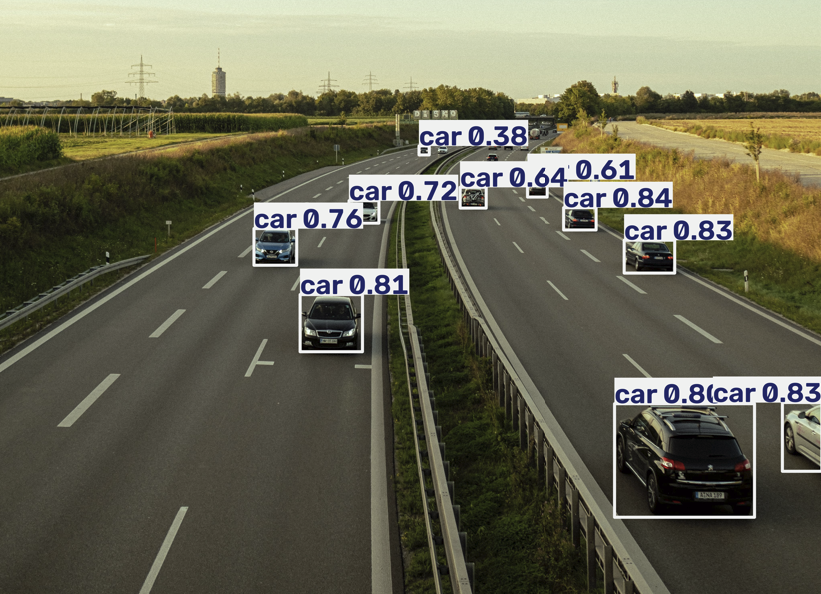

# traffic-vision

**Embedded computer vision for traffic monitoring and analysis.**

This is an embedded computer vision project that uses YOLO11 and OpenCV for object detection, tracking, and counting using existing traffic footage. The system implements object tracking, which is used in traffic analysis to count the number of cars that cross a specified virtual line. The project was deployed on an NVIDIA Jetson Nano and compared against inference performance on my laptop. 

## Features 

* __Object Detection__: Vehicle and pedestrian detection using YOLO11n, YOLO11s, and YOLO11m models
* __Object Tracking__: Custom-implemented multi-object tracking with bounding-box estimation, intersection over union, and the Hungarian algorithm for persistence across missed frames
* __Vehicle Counting__: Use multi-object tracking to count the net vehicle flow across a specified line
* __Performance Benchmarking__: Measured inference speed across different hardware platforms
* __Embedded Deployment__: Deployed on an NVIDIA Jetson Nano with CUDA acceleration

## Data 

Roadway video data is sourced from: https://zenodo.org/records/14041920

## Results and Benchmarks 

| Platform | GPU | Model | Input Resolution | Mean Inference FPS |
| --- | --- | --- | --- | --- |
| Laptop | RTX 4050 | YOLO11n | 640 | 158.8 |
| Laptop | RTX 4050 | YOLO11m | 640 | 64.6 |
| Jetson Nano | Maxwell | YOLO11n | 640 | 9.2 |
| Jetson Nano | Maxwell | YOLO11n | 416 | 14.5 |

Inference performance was measured excluding the first 10 frames of the video data. Measurements include model processing, inference, and postprocessing, but exclude video decoding and display overhead. 

